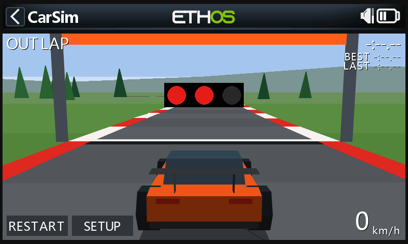
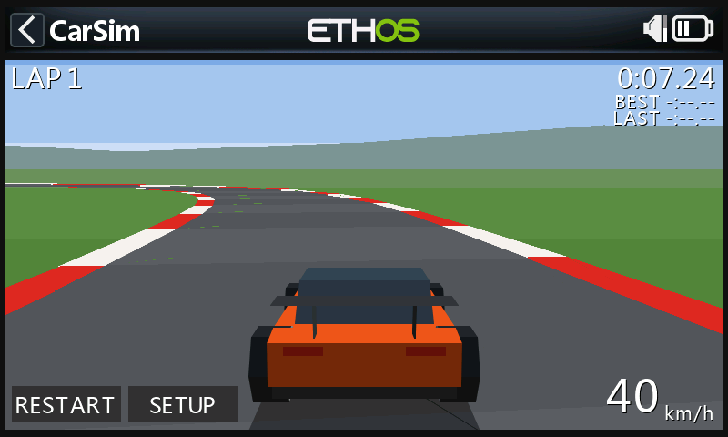

# CarSim

A 3D track racing game for FrSky Ethos radios, made for the **FrSky Velox VX10** surface radio and driven with its wheel and trigger. It also plays on stick radios.

| On the grid | Racing |
| --- | --- |
|  |  |

*Screenshots from the Ethos simulator (VX10).*

The camera sits behind the car, as in most racing games. The car is the low-poly car from gripora-lua-ethos-suite (`app/plane3d.lua`, the Gripora Configurator's preview car): orange body, rear wing, and front wheels that turn with the steering. The circuit is about 1.25 km: a long main straight, a fast sweeper, S-bends and a tight infield, with red and white kerbs, trees and a start gantry.

The sim is built the same way as [plane-sim](https://github.com/robthomson/plane-sim) and [heli-sim](https://github.com/robthomson/heli-sim): same renderer, tooling and performance approach.

## Racing

- It is a time trial. Three red lights count down, then the race is on. The first crossing of the line starts lap 1; every lap after that is timed, and the best lap is saved.
- **VX10** (Controls: Auto, or Wheel + trigger): the wheel steers. Pull the trigger to accelerate, push it to brake, and keep pushing once stopped to reverse.
- **Stick radios** (Controls: Auto, or Sticks): aileron steers, the throttle stick is the accelerator, and pulling the elevator stick back brakes and reverses. The throttle stick does not centre, so it cannot brake.
- The car is rear-wheel drive. Too much throttle in a corner steps the tail out. Steering lock shrinks as speed rises.
- The grass has less grip and slows the car. A long way off the circuit, the car is put back on the track.

| Control | Action |
| --- | --- |
| **RESTART** (touch) / Enter | Back to the grid |
| **SETUP** (touch) / Page | Settings |
| Back arrow (touch) / Exit | Close the settings, then the tool |
| Rotary | Camera distance |

The VX10 is touch only (no Enter, Page or Exit keys), so the on-screen buttons and the title bar back arrow are the way round it. The buttons also work on the X-series touch screens.

Settings (saved to `carsim.cfg` next to the script):

| Setting | Default | Range |
| --- | --- | --- |
| Controls | Auto | Auto (wheel on a VX10, sticks elsewhere), Wheel + trigger, Sticks |
| Steering | 100% | 20–100% of full lock |
| Steering expo | 20% | 0–90% |
| Camera distance | 100% | 50–200% |
| Speed | km/h | km/h, mph |
| Detail | Low | Low, High (two-tier trees) |
| Show CPU stats | Off | |
| Clear best lap | | |

Sources are analog inputs by number: on the VX10, member 0 is the wheel and member 1 the trigger. On stick radios, member 1 is the elevator, 2 the throttle and 3 the aileron, so the stick mode does not matter.

## Layout

- `src/carsim/main.lua`: registers the system tool
- `src/carsim/sim.lua`: app state, controls, laps, settings, HUD and touch buttons
- `src/carsim/lib/physics.lua`: car model (single-track, tyre forces that saturate, rear-drive friction circle, power-limited engine, brakes, reverse, grass)
- `src/carsim/lib/track.lua`: the circuit (Catmull-Rom spline sampled every 8 m: edges, kerbs, lap distance, nearest-sample lookup, tree placement)
- `src/carsim/lib/car.lua`: the car mesh (about 110 faces, built in stages), front wheel steering
- `src/carsim/lib/render.lua`: chase camera, scenery, projection, display lists
- `tools/headless.py`: runs the sim headless with an autopilot or scripted inputs, counts Lua instructions per callback, saves frames and a top-down map as PNG
- `tools/make_icon.py`: draws `gfx/icon.png` from the mesh

## Performance

Ethos aborts a `paint` that runs about 20000 Lua instructions; `wakeup` is not held to that budget. So `wakeup` does all the work into flat display lists and `paint` only replays them. In the VX10 simulator, `paint` uses about 20% of its budget at 33 Hz.

The circuit is flat and its pieces do not overlap, so the ground needs no sorting. Each track sample's four edge points are projected once per frame and shared by the quads either side; only the few quads that cross the edge of the view are clipped. Beyond 70 m, segments are drawn in pairs, and beyond 130 m the kerbs are left out. Trees and the gantry are sorted far to near and split around the car.

Ethos Lua uses 32-bit floats; the headless runner (lupa) uses 64-bit, so check anything numerically delicate on the simulator.

## VS Code deploy

- `Deploy & Launch [SIM]`
- `Deploy Radio`, `Deploy Radio [Fast]`
- `Deploy Radio + Serial Debug`

The simulator target comes from the Ethos extension settings in `.vscode/settings.json` (`ethos.board`, `ethos.protocol`, `ethos.release`, `ethos.simulatorsFolder`); set it to `VX10`, `FCC`, `nightly26`, `simulators`. The scripts go to `simulators/<BOARD>_<PROTOCOL>@<release>/scripts/carsim`. Ethos loads the scripts when the radio starts, so restart the simulator after a deploy.

## Testing

Headless:

```text
pip install lupa pillow
python tools/headless.py --seconds 120 --map          # autopilot laps, top-down map
python tools/headless.py --scenario straight --frames 150
python tools/headless.py --sticks --scenario spin     # stick controls
```

The script prints position, speed, lap, surface and instruction counts, and writes frames to `tools/out/`. Its paint counts include the Lua stand-ins for `lcd` calls, so they are higher than on a radio.

In the Ethos WASM simulator, with [ethos-tools](https://github.com/FrSkyRC/ethos-tools) `simulation/run_wasm.js --serve` and a VX10 build: `analog 0 V` turns the wheel, `analog 1 V` pulls the trigger, and `tap` presses the touch buttons.
